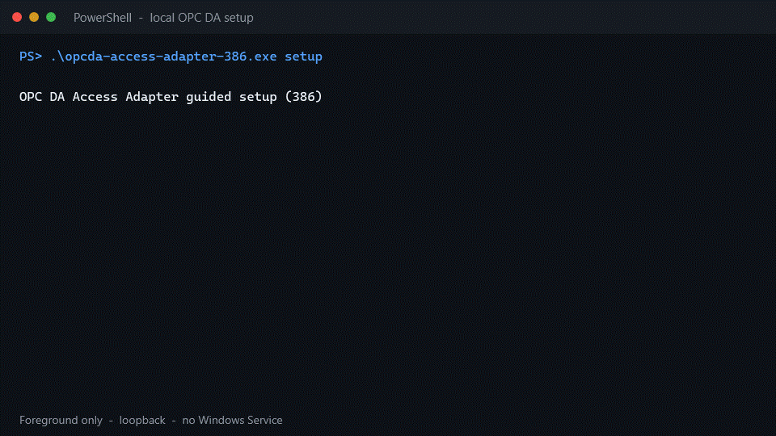

# Quick start

You need Windows, an installed local OPC DA server, Git, and the Go version
declared in [`go.mod`](../go.mod). The adapter architecture must match the
server's COM registration.



This 12-second demo is a sanitized replay of the executed `windows/386`
Graybox setup recorded in the [compatibility evidence](validation/compatibility.md).
It starts a foreground loopback listener with Write disabled; it does not
install a Windows Service. The same steps are available as copyable text below.
If your Markdown viewer honors reduced-motion settings and shows a still image,
[open the animation directly](assets/setup-demo.gif).

## 1. Build

```powershell
git clone https://github.com/east-true/opcda-access-adapter.git
Set-Location opcda-access-adapter
go build -trimpath -o opcda-access-adapter.exe ./cmd/adapter
```

For a 32-bit-only registration, build the x86 executable instead:

```powershell
$env:GOARCH = "386"
go build -trimpath -o opcda-access-adapter-386.exe ./cmd/adapter
Remove-Item Env:GOARCH
```

A 64-bit executable cannot see a 32-bit-only COM registration. If the server
bitness is unknown, run `detect` with both builds.

## 2. Inspect local registrations

```powershell
.\opcda-access-adapter.exe detect
```

Detection returns a bounded JSON inventory of local OPC DA 2.0 registrations.
It does not activate a vendor server, select one automatically, change
configuration, or search remote machines. An empty list is a successful
result. See [local server detection](operations/local-detection.md).

## 3. Configure and run

```powershell
.\opcda-access-adapter.exe setup
```

The guided flow requires four explicit decisions:

1. choose one detected source;
2. choose HTTP, gRPC, OPC UA, or MCP stdio;
3. choose foreground, Windows Service, or save-only execution;
4. review the exact configuration before it is written or started.

For the shortest first run, choose **HTTP/JSON** and **current terminal**.
HTTP listens on `127.0.0.1:8080` by default and Write remains disabled. Setup
never silently overwrites a file or service and never changes COM/DCOM or
firewall permissions.

## 4. Check status

```powershell
Invoke-RestMethod http://127.0.0.1:8080/v1/status
```

The response should name the selected source and eventually report
`connected`. A registration discovered by `detect` is not proof that the
vendor server can activate under the current Windows identity.

## 5. Read a known ItemID

```powershell
$body = @{
    source = "device"
    items  = @(@{ itemId = "Vendor.Example.Item" })
} | ConvertTo-Json -Depth 4

Invoke-RestMethod `
    -Method Post `
    -Uri http://127.0.0.1:8080/v1/read `
    -ContentType application/json `
    -Body $body
```

Use the exact ItemID accepted by the source. Browse is optional in OPC DA;
known-ItemID Read remains available when the source does not support Browse.

For service installation, saved configurations, OPC UA identity fields, and
the original environment-variable workflow, continue with the
[setup and Windows Service guide](operations/setup.md).
